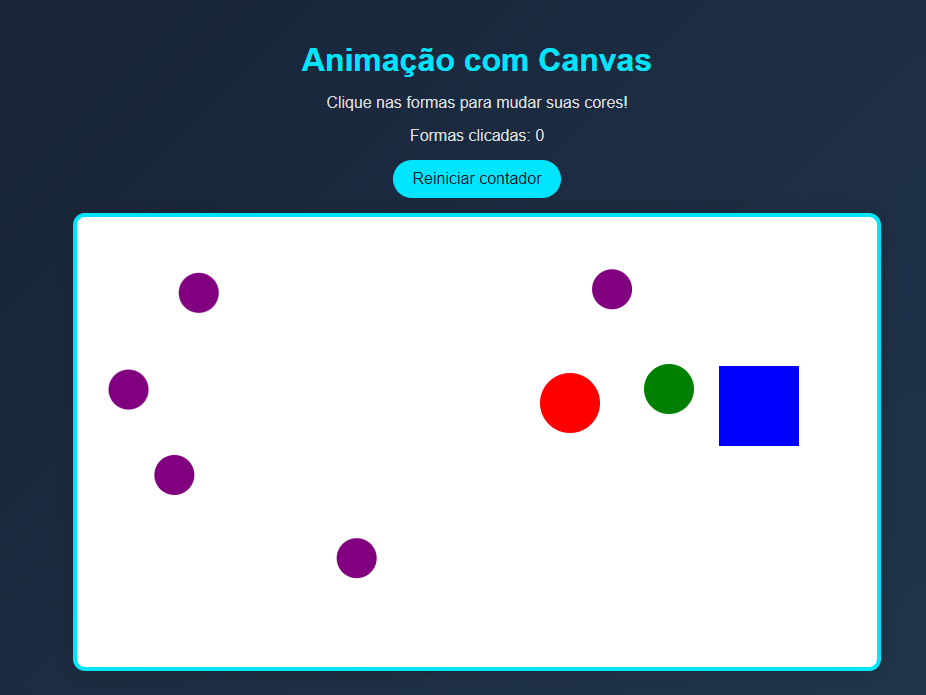

 Animação com Canvas

Projeto desenvolvido como atividade prática da disciplina **Desenvolvimento em JavaScript**, do curso de Análise e Desenvolvimento de Sistemas.

A aplicação utiliza HTML5 Canvas e JavaScript para criar uma animação interativa com formas geométricas que se movimentam pela tela e mudam de cor quando clicadas pelo usuário.

 Objetivo do projeto

Desenvolver uma animação utilizando o elemento HTML5 Canvas e JavaScript, aplicando conceitos de desenho gráfico, movimentação de objetos, estruturas de repetição e interação com o usuário.

 Tecnologias utilizadas

- **HTML5:** estruturação da página e criação da área Canvas.
- **CSS3:** estilização da interface, cores, bordas, efeitos e layout.
- **JavaScript:** lógica da animação, movimentação dos objetos e interações.
- **Visual Studio Code:** ambiente utilizado para desenvolvimento.
- **Git e GitHub:** controle de versão e publicação do projeto.

 Funcionalidades

- Exibição de círculos e quadrados animados.
- Movimentação contínua das formas geométricas.
- Rebatimento dos objetos ao atingir as bordas do Canvas.
- Alteração aleatória das cores ao clicar nas formas.
- Contador de cliques realizados pelo usuário.
- Botão para reiniciar o contador.
- Criação automática de cinco círculos adicionais utilizando a estrutura de repetição `for`.
- Geração de posições e velocidades aleatórias com `Math.random()`.

 Como executar o projeto

Não é necessário instalar dependências ou utilizar um servidor.

1. Faça o download ou clone este repositório.
2. Abra a pasta `AnimacaoCanvas`.
3. Localize o arquivo `index.html`.
4. Abra o arquivo em um navegador, como Google Chrome ou Microsoft Edge.
5. Clique nas formas geométricas para alterar suas cores e testar as funcionalidades.

 Estrutura do projeto

```text
AnimacaoCanvas/
│
├── index.html
├── style.css
├── script.js
└── README.md
```

 Conceitos de JavaScript aplicados

Durante o desenvolvimento foram utilizados:

- Variáveis e constantes.
- Arrays e objetos.
- Estruturas de repetição (`for`).
- Estruturas condicionais (`if`).
- Funções.
- Eventos de mouse (`click`).
- Métodos `push()` e `forEach()`.
- Geração de valores aleatórios com `Math.random()`.
- Animação com `requestAnimationFrame()`.
- Manipulação de elementos HTML pelo DOM.

 Autor

**Ricarte Ubirajara Luis**

Curso: Análise e Desenvolvimento de Sistemas

Disciplina: Desenvolvimento em JavaScript

Universidade: Pitágoras Unopar Anhanguera

Uberaba – MG | 2026


## 🖼️ Resultado do projeto


---

*Projeto acadêmico desenvolvido para fins de aprendizagem e prática de programação JavaScript.*
